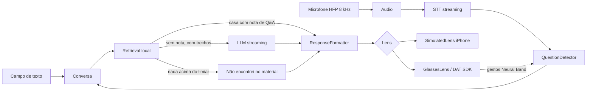

# Arquitetura — Teleprompter Meta

Visão das partes do sistema e de como se conectam. Cada parte aqui ganha uma linha em [TESTING.md](TESTING.md). Decisões difíceis de reverter viram ADR em [adr/](adr/).
Parte com UI tem suas telas em [../design/telas.md](../design/telas.md).

Status: aprovada em 2026-11-08 (revisão de 2026-11-08 aprovada)

## 1. Contexto
- O que o sistema faz: ouve a pergunta, recupera contexto do meu material e mostra resposta curta na lente (PRD US-01 a US-11).
- Quem usa e quem integra: eu, como único usuário. Integra com Meta Wearables DAT SDK (óculos, Neural Band), serviço de STT e provedor de LLM (ADR-005, a decidir).
- Restrições: uso pessoal, sem App Store, latência mínima, iOS 17.2+, iPhone físico, microfone dos óculos a 8 kHz mono via HFP, lente 600x600, SDK em developer preview.

## 2. Partes do sistema

| Parte | Responsabilidade | Tecnologia | Dono / pasta | Depende de | Dado sensível? | Status |
|---|---|---|---|---|---|---|
| Interface iPhone | Chat (mensagens, texto, microfone), conversas, configurações, importação, ensaio, lente simulada | SwiftUI | `Teleprompter/UI` | Domínio | Não | Implementado (T01 a T05, T07) |
| Conversa | Orquestra entradas (texto, microfone, escuta contínua), mensagens e fontes | Swift puro (ViewModel) | `Teleprompter/Domain` | Retrieval, STT | Não | Implementado |
| Audio | Captura do microfone (iPhone ou HFP dos óculos) | AVAudioEngine | `Teleprompter/Audio` | - | Sim (voz) | Implementado (microfone do iPhone e arquivos) |
| STT | Transcrição em streaming e download on-demand de asset de fala (SpeechAssetManager) | SpeechAnalyzer ou alternativa (ADR-003) | `Teleprompter/STT` | Audio | Sim | Implementado (on-device pt-BR) |
| QuestionDetector | Detecta fim da pergunta | Swift puro | `Teleprompter/Domain` | STT | Não | Implementado |
| Retrieval | Busca em Q&A, documentos e código | SQLite FTS5 + BM25 (ADR-0006) | `Teleprompter/Retrieval` | Persistência | Não | Implementado |
| LLM | Resposta com streaming a partir do contexto (Apple, OpenRouter ou Personalizado) | Provedor externo ou local (ADR-005, issue #75) | `Teleprompter/LLM` | Retrieval | Sim (pergunta enviada se externo) | Implementado (Apple, OpenRouter OAuth PKCE e Personalizado) |
| ResponseFormatter | Ajusta ao formato e ao limite da lente | Swift puro | `Teleprompter/Domain` | LLM, Retrieval | Não | Implementado |
| Lens (protocolo) | Saída da resposta | `SimulatedLens` e `GlassesLens` | `Teleprompter/Lens` | Formatter | Não | Implementado (SimulatedLens); GlassesLens pendente |
| Glasses | Isola o DAT SDK: registro, microfone, display, gestos | MWDATCore, MWDATDisplay | `Teleprompter/Glasses` | DAT SDK | Não | Não implementado (fase 3) |
| Persistência | Configurações, índice, notas de Q&A, conversas | SQLite3 do sistema / UserDefaults | `Teleprompter/Storage` | - | Sim (perguntas e respostas salvas) | Implementado (ConversationStore e SettingsStore com migração) |
| Segredos | Chaves do LLM isoladas por provedor | Keychain | `Teleprompter/Storage` | - | Sim | Implementado (KeychainStore: Personalizado e OpenRouter) |
| Infra e CI | Build e testes | XcodeGen, GitHub Actions macOS, lefthook | `.github`, `project.yml` | - | - | Implementado |

Sem backend próprio, sem jobs/filas, sem autenticação de usuário.

### 2.1. Estado de implementação por componente

#### O que está implementado:
- Interface iPhone (SwiftUI): casca de navegação `RootTabView` com 4 abas (Chat, Material, Ensaio, Ajustes); tela de Chat T02 (`ChatView`), importação de material T04 (`MaterialView`), ensaio T05 (`EnsaioView`), configurações T03 (`SettingsView`), lista de conversas T07 (`ConversationsView`) e modal de lente simulada T01 (`SimulatedLensModalView`, `LensView`).
- Composição com `AppEnvironment`: injeção de dependência centralizada em `AppEnvironment` com fábricas `production()` (componentes com SQLite persistente, microfone real e SpeechAnalyzer) e `preview()` / `test()` (doubles em memória isolados sem I/O de disco).
- Conversa e Domínio: `ConversationViewModel`, `AnswerPipeline`, modelos de domínio (`Models.swift`), relatórios de latência (`LatencyReport.swift`).
- Audio: `MicrophoneAudioSource` (captura do microfone local via AVAudioEngine em 16 kHz / 8 kHz) e `FileAudioSource` (decodificação de arquivos WAV).
- STT: `SpeechAnalyzerTranscriber` (transcrição contínua com SpeechAnalyzer para pt-BR), `SpeechAssetManager` (`SystemSpeechAssetManager`), cálculo de `WordErrorRate`.
- QuestionDetector: protocolo `QuestionDetector` e implementação `PauseQuestionDetector` com detecção de silêncio após fala.
- Retrieval: `LocalRetriever` com índice SQLite FTS5 e ranking BM25, `Embedder` com vetorização de texto, `MaterialImporter` para chunking e indexação de arquivos de texto e código, `ProductionAppRetriever` e `QANoteOnlyRetriever`.
- LLM: protocolo `AnswerGenerator` com geradores para três provedores configuráveis em T03:
  1. `apple`: modelo on-device via `FoundationModelsAnswerGenerator` (`SystemLanguageModel.default`), sem envio de rede nem necessidade de chaves (exige Apple Intelligence ligado e iOS compatível).
  2. `openrouter`: login via OAuth PKCE (`OpenRouterAuthService`, protocolo `OpenRouterAuthenticating`, callback https em GitHub Pages (`site/oauth/`) que repassa ao scheme `teleprompter://`, `ASWebAuthenticationSession`), chave persistida no Keychain sob `llm.openrouter.apiKey`, endpoint `https://openrouter.ai/api/v1` em formato `.openAI`, modelo padrão `anthropic/claude-haiku-5.5` editável.
  3. `custom`: `StreamingAnswerGenerator` com formato configurável (`.openAI` ou `.anthropic`), URL base e modelo customizados, autenticado via chave no Keychain sob `llm.apiKey`.
- Formatter: protocolo `ResponseFormatter` e implementação `LensFormatter` com formatação em bullets curtos, palavras-chave e texto corrido, respeitando a grade de 5 linhas por 28 colunas da lente 600x600.
- Lens: protocolo `Lens`, implementação observável `SimulatedLens` e componente visual `LensView` com design escuro de alto contraste.
- Persistência: `ConversationStore` com backend SQLite persistente (`SQLiteConversationStore` com WAL e migrações versionadas) e em memória (`InMemoryConversationStore`); `SettingsStore` com backend `UserDefaultsSettingsStore` e `InMemorySettingsStore`, com suporte a migração automática de configurações legadas de provedor.
- Segredos: protocolo `SecretStore` com implementação segura `KeychainStore` sobre a Keychain do iOS e `InMemorySecretStore` para testes, garantindo chaves isoladas por provedor (`SettingsConstants.llmApiKeySecretKey` e `SettingsConstants.openRouterApiKeySecretKey`).

#### O que NÃO está implementado (fases 3 a 5):
- Módulo `Glasses` e Meta DAT SDK: módulos `MWDATCore` e `MWDATDisplay` ainda não integrados; dependência ausente em `project.yml`.
- Óculos reais (Meta Ray-Ban Display): pareamento físico, microfone HFP a 8 kHz via Bluetooth dos óculos e saída no prisma óptico do display (fase 3).
- Tela T06 (Pareamento e estado dos óculos): interface conectada ao hardware físico do DAT SDK (fase 3).
- Meta Neural Band: detecção de gestos para repetição ou descarte de resposta (fase 4).

### 2.2. Decisões arquiteturais tomadas no código

- Caminho Q&A sem LLM quando não há chave: quando a chave de API não está presente no Keychain ou a URL/modelo do provedor não estão configurados, `AppEnvironment.makeGenerator` retorna `nil`. O pipeline opera em modo restrito a Q&A sem gerar erro de rede: se houver nota de Q&A correspondente, ela é entregue diretamente; se houver apenas trechos gerais de documentos, o resultado é esvaziado para responder a mensagem padrão "Não encontrei isso no seu material." (RAG estrito).
- `QANoteOnlyRetriever`: decorador estrutural que envolve qualquer instância de `Retriever`. Quando ativo, descarta trechos de documentos e código (`chunks = []`), preservando exclusivamente correspondências com notas de Q&A preparadas (`qaNote`). Usado quando o gerador de LLM não está configurado, protegendo o apresentador contra respostas incompletas sem modelo.
- Limiares relidos dinamicamente por pergunta: em cada pergunta processada no chat (`ConversationViewModel.handleQuestion`), a chamada `resolvePipeline()` recarrega as opções do `SettingsStore`. O limiar de silêncio do `PauseQuestionDetector`, o formato de exibição da resposta e o provedor de LLM são atualizados em tempo de execução sem exigir reinício do app.
- `ProductionAppRetriever`: adaptador thread-safe que une o protocolo de busca `Retriever` e o protocolo de indexação `MaterialIndexable`. Gerencia o ciclo de vida do `LocalRetriever` sobre banco SQLite no diretório Application Support da aplicação, relendo os limiares de busca (`qaThreshold`, `chunkThreshold`, `topK`) sob lock e recriando a instância subjacente quando as configurações do usuário são alteradas na tela T03.
- Composição `AppEnvironment`: separação clara entre a fábrica `production()` (usada no lançamento do app pelo `TeleprompterApp`) e as fábricas `preview()` e `test()` (usadas nos previews do SwiftUI e na suíte de testes de integração `AppEnvironmentIntegrationTests`), garantindo isolamento hermético entre ambiente de produção e fixtures de desenvolvimento.
- Provedores de LLM e migração de configurações (issue #75): o seletor de provedores em T03 oferece Apple (on-device), OpenRouter (login OAuth PKCE) e Personalizado (OpenAI ou Anthropic SSE). A persistência em `Settings` migra transparentemente valores salvos `openai` ou `anthropic` para `custom` com o respectivo formato `llmFormat`, preservando URL base e modelo. As chaves de API são armazenadas em chaves distintas no Keychain (`llm.apiKey` para Personalizado e `llm.openrouter.apiKey` para OpenRouter), impedindo sobrescritas acidentais entre provedores.

## 3. Diagrama

## 4. Fluxos principais
- Chat (US-12 a US-14): texto ou microfone entra como mensagem, segue o mesmo caminho da busca; sem trecho acima do limiar, a resposta é "não encontrei no seu material" e o LLM não é chamado.
- Pergunta ao vivo (US-01 a US-05): áudio, transcrição parcial, fim detectado, busca, resposta direta ou via LLM, formatação, lente.
- Gesto (US-09): Neural Band, Glasses, pedir de novo ou pular a resposta atual.
- Importação (US-11): selecionar material, indexar, disponibilizar à busca.

## 5. Dados
- Entidades: ver [docs/DATA.md](DATA.md).
- Retenção, backup e migração: índice reconstruível a partir das fontes; notas de Q&A versionadas no repositório de material.

## 6. Segurança e privacidade
- Autenticação / autorização: N/A (uso pessoal). Chave de LLM no Keychain.
- Segredos: variáveis de ambiente, nunca no repositório. Lista em `.env.example`.
- Dados pessoais e LGPD: a voz e o texto da pergunta saem para STT/LLM externos se o provedor não for local; registrar no ADR-005. Sem log de transcrição em texto claro.

## 7. Ambientes e deploy
- Ambientes: Simulator, iPhone físico, iPhone com óculos.
- Portas locais: N/A (app nativo sem dev server).
- Deploy: instalação direta no iPhone pelo Xcode; sem distribuição. Rollback: reinstalar commit anterior.

## 8. Qualidade e operação
- Estratégia de testes: [TESTING.md](TESTING.md).
- Observabilidade: logs locais com os.Logger, sem conteúdo da fala; tempos por etapa para medir latência.
- Requisitos não funcionais (metas a validar nos protótipos): primeiro texto em menos de 2 s, WER abaixo de 15%, sessão de 60 min sem falha.

## 9. Riscos e dívida conhecida
- DAT SDK em developer preview pode mudar: isolado no módulo Glasses.
- Display não vendido no Brasil e acesso do Developer Center por país: validar antes da compra (gate G1).
- Qualidade do STT a 8 kHz: medir no protótipo P1.
- Mock Device Kit não simula display nem microfone: mitigado pela lente simulada.
- Banca em novembro de 2027 e auxílio permitido (colegas e documento nos óculos): sem risco de proibição. Congelar versões do SDK e dos óculos nas semanas antes (ADR-0008).

## 10. Decisões (ADR)
Fonte original: aba ADRs do documento do plano. Propostas se decidem nos gates G1 e G2.

| ADR | Decisão | Status |
|---|---|---|
| [0001](adr/0001-swift-nativo-com-dat-sdk.md) | Swift nativo com Meta DAT SDK | aceita |
| [0002](adr/0002-orquestracao-no-iphone.md) | Orquestração no iPhone, sem servidor próprio | proposta (G1) |
| [0003](adr/0003-stt-on-device-da-apple.md) | STT on-device da Apple, nuvem como alternativa | proposta (G1) |
| [0004](adr/0004-busca-local-com-caminho-rapido-qa.md) | Busca local com caminho rápido pelo Q&A | proposta (G1) |
| [0005](adr/0005-llm-rapido-em-nuvem-com-streaming.md) | LLM rápido em nuvem com streaming | proposta (G1) |
| [0006](adr/0006-indice-sqlite-com-embeddings.md) | Índice SQLite (FTS5) com embeddings no aparelho | proposta (G1) |
| [0007](adr/0007-protocolos-com-implementacoes-simuladas.md) | Protocolos com implementações simuladas | proposta (G2) |
| [0008](adr/0008-dat-sdk-isolado-e-versoes-fixadas.md) | DAT SDK isolado e versões fixadas | proposta (G2) |
| [0009](adr/0009-rag-fechado-no-chat.md) | RAG fechado no chat: só material inserido, sem invenção | proposta (G1) |
