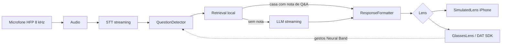

# Arquitetura — Teleprompter Meta

Visão das partes do sistema e de como se conectam. Cada parte aqui ganha uma linha em [TESTING.md](TESTING.md). Decisões difíceis de reverter viram ADR em [adr/](adr/).
Parte com UI tem suas telas em [../design/telas.md](../design/telas.md).

Status: aprovada em 2026-11-08

## 1. Contexto
- O que o sistema faz: ouve a pergunta, recupera contexto do meu material e mostra resposta curta na lente (PRD US-01 a US-11).
- Quem usa e quem integra: eu, como único usuário. Integra com Meta Wearables DAT SDK (óculos, Neural Band), serviço de STT e provedor de LLM (ADR-005, a decidir).
- Restrições: uso pessoal, sem App Store, latência mínima, iOS 17.2+, iPhone físico, microfone dos óculos a 8 kHz mono via HFP, lente 600x600, SDK em developer preview.

## 2. Partes do sistema

| Parte | Responsabilidade | Tecnologia | Dono / pasta | Depende de | Dado sensível? |
|---|---|---|---|---|---|
| Interface iPhone | Configurações, importação, ensaio, lente simulada | SwiftUI | `App/UI` | Domínio | Não |
| Audio | Captura do microfone (iPhone ou HFP dos óculos) | AVAudioEngine | `App/Audio` | - | Sim (voz) |
| STT | Transcrição em streaming | SpeechAnalyzer ou alternativa (ADR-003) | `App/STT` | Audio | Sim |
| QuestionDetector | Detecta fim da pergunta | Swift puro | `App/Domain` | STT | Não |
| Retrieval | Busca em Q&A, documentos e código | SQLite FTS5 + embeddings (ADR-0006) | `App/Retrieval` | Persistência | Não |
| LLM | Resposta com streaming a partir do contexto | Provedor externo (ADR-005) | `App/LLM` | Retrieval | Sim (pergunta enviada) |
| ResponseFormatter | Ajusta ao formato e ao limite da lente | Swift puro | `App/Domain` | LLM, Retrieval | Não |
| Lens (protocolo) | Saída da resposta | `SimulatedLens` e `GlassesLens` | `App/Lens` | Formatter | Não |
| Glasses | Isola o DAT SDK: registro, microfone, display, gestos | MWDATCore, MWDATDisplay | `App/Glasses` | DAT SDK | Não |
| Persistência | Configurações, índice, notas de Q&A | Arquivos/SwiftData | `App/Storage` | - | Não |
| Segredos | Chave do LLM | Keychain | `App/Storage` | - | Sim |
| Infra e CI | Build e testes | XcodeGen, GitHub Actions macOS, lefthook | `.github`, `project.yml` | - | - |

Sem backend próprio, sem jobs/filas, sem autenticação de usuário.

## 3. Diagrama

## 4. Fluxos principais
- Pergunta ao vivo (US-01 a US-05): áudio, transcrição parcial, fim detectado, busca, resposta direta ou via LLM, formatação, lente.
- Gesto (US-09): Neural Band, Glasses, pedir de novo ou pular a resposta atual.
- Importação (US-11): selecionar material, indexar, disponibilizar à busca.

## 5. Dados
- Entidades: ver [docs/DATA.md](DATA.md).
- Retenção, backup e migração: índice reconstruível a partir das fontes; notas de Q&A versionadas no repositório de material.

## 6. Segurança e privacidade
- Autenticação / autorização: N/A (uso pessoal). Chave de LLM no Keychain.
- Segredos: variáveis de ambiente, nunca no repositório. Lista em `.env.example`.
- Dados pessoais e LGPD: a voz e o texto da pergunta saem para STT/LLM externos se o provedor não for local; registrar no ADR-005. Sem log de transcrição em texto claro.

## 7. Ambientes e deploy
- Ambientes: Simulator, iPhone físico, iPhone com óculos.
- Portas locais: N/A (app nativo sem dev server).
- Deploy: instalação direta no iPhone pelo Xcode; sem distribuição. Rollback: reinstalar commit anterior.

## 8. Qualidade e operação
- Estratégia de testes: [TESTING.md](TESTING.md).
- Observabilidade: logs locais com os.Logger, sem conteúdo da fala; tempos por etapa para medir latência.
- Requisitos não funcionais (metas a validar nos protótipos): primeiro texto em menos de 2 s, WER abaixo de 15%, sessão de 60 min sem falha.

## 9. Riscos e dívida conhecida
- DAT SDK em developer preview pode mudar: isolado no módulo Glasses.
- Display não vendido no Brasil e acesso do Developer Center por país: validar antes da compra (gate G1).
- Qualidade do STT a 8 kHz: medir no protótipo P1.
- Mock Device Kit não simula display nem microfone: mitigado pela lente simulada.
- Banca em novembro de 2027 e auxílio permitido (colegas e documento nos óculos): sem risco de proibição. Congelar versões do SDK e dos óculos nas semanas antes (ADR-0008).

## 10. Decisões (ADR)
Fonte original: aba ADRs do documento do plano. Propostas se decidem nos gates G1 e G2.

| ADR | Decisão | Status |
|---|---|---|
| [0001](adr/0001-swift-nativo-com-dat-sdk.md) | Swift nativo com Meta DAT SDK | aceita |
| [0002](adr/0002-orquestracao-no-iphone.md) | Orquestração no iPhone, sem servidor próprio | proposta (G1) |
| [0003](adr/0003-stt-on-device-da-apple.md) | STT on-device da Apple, nuvem como alternativa | proposta (G1) |
| [0004](adr/0004-busca-local-com-caminho-rapido-qa.md) | Busca local com caminho rápido pelo Q&A | proposta (G1) |
| [0005](adr/0005-llm-rapido-em-nuvem-com-streaming.md) | LLM rápido em nuvem com streaming | proposta (G1) |
| [0006](adr/0006-indice-sqlite-com-embeddings.md) | Índice SQLite (FTS5) com embeddings no aparelho | proposta (G1) |
| [0007](adr/0007-protocolos-com-implementacoes-simuladas.md) | Protocolos com implementações simuladas | proposta (G2) |
| [0008](adr/0008-dat-sdk-isolado-e-versoes-fixadas.md) | DAT SDK isolado e versões fixadas | proposta (G2) |
